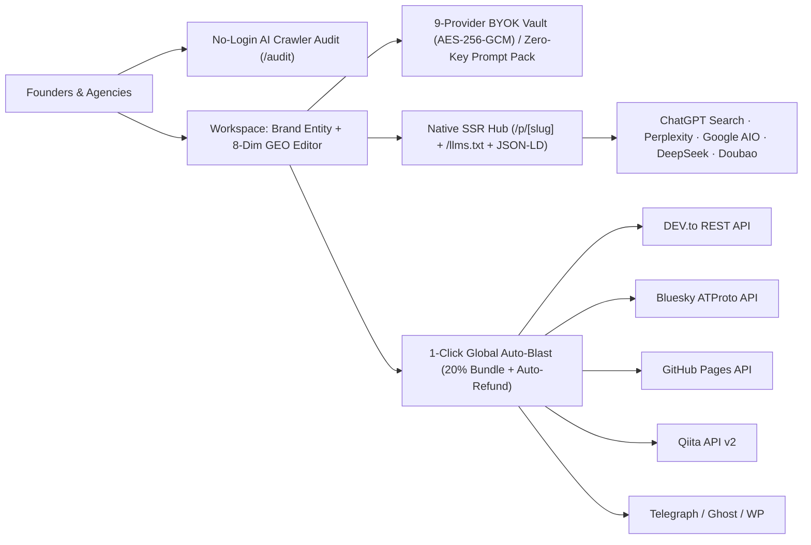

# 🚀 GeoPulse Studio (v4.2 Global)

**The Open-Source, Full-Stack Commercial GEO (Generative Engine Optimization) & Global Official-API Auto-Syndication Platform.**

[](https://geo.workagentpro.com)
[](https://geo.workagentpro.com/audit)
[](https://huggingface.co/spaces/sylviacccyu/geopulse-studio)
[](./LICENSE)

> **Stop paying \$499–\$1,500+/month for passive AI visibility dashboards.**
> GeoPulse Studio combines **Website AI Crawler Auditing**, **5-Engine × 8-Dimension GEO Content Scoring & Auto-Fix**, **Native SSR `/llms.txt` + 4-in-1 JSON-LD Hosting**, **Competitor Share-of-Voice (SOV) Tracking**, **White-Label Agency PDF Reports**, and **One-Click Official-API Global Syndication** — all MIT open-source and deployable on a single \$5/mo VPS with Docker.

[Live Production App](https://geo.workagentpro.com) · [Free Website AI Crawler Audit](https://geo.workagentpro.com/audit) · [Live `/llms.txt` Index](https://geo.workagentpro.com/llms.txt) · [Commercial & Acquisition Info](./COMMERCIAL_AND_ACQUISITION.md)

---

## ✨ Why GeoPulse Studio? (2026 Market Comparison)

In 2025–2026, enterprise platforms acquired monitoring-only GEO tools at massive valuations (HubSpot → XFunnel, Sitecore → Scrunch AI, Adobe → Semrush), leaving SMBs, SaaS founders, and boutique agencies with **expensive read-only dashboards** that still fail to fix sites or publish structured content.

| Capability | **GeoPulse Studio 4.2** | Profound | Scrunch AI | Peec AI | Otterly.ai |
| :--- | :--- | :--- | :--- | :--- | :--- |
| **License & Pricing** | **MIT Open-Source (\$0) / Cloud \$0–\$39/mo** | \$499–\$1,500+/mo | Enterprise custom | \$99–\$399/mo | \$29–\$189/mo |
| **Free Website AI Crawler Audit** | ✅ 6 AI bots, `/llms.txt`, SSR, JSON-LD (`/audit`) | ❌ | ✅ | ❌ | ❌ |
| **8-Dim GEO Scoring & 6-Click Auto-Fix** | ✅ Real-time bilingual (EN + ZH) | ❌ | ⚠️ Advice only | ❌ | ❌ |
| **Native SSR `/llms.txt` + 4-in-1 JSON-LD** | ✅ Built-in `/p/[slug]`, `/hub`, `/sitemap.xml` | ❌ | ⚠️ Proxy | ❌ | ❌ |
| **1-Click Official-API Global Syndication** | ✅ DEV.to, Bluesky, GitHub Pages, Qiita, Telegraph, Ghost, WP | ❌ | ❌ | ❌ | ❌ |
| **BYOK LLM + Zero-Key Prompt Packs** | ✅ 9 Providers (OpenAI, Gemini, DeepSeek, OpenRouter, etc.) | Closed | Closed | Closed | Closed |
| **White-Label Agency Billing & Credits** | ✅ Multi-tenant, Redemption Codes, Credits Wallet, PDF Reports | Enterprise | Enterprise | Agency tier | ❌ |
| **Global + China AI Engines** | ✅ ChatGPT, Perplexity, Gemini + DeepSeek, Kimi, Doubao | EN only | EN only | EN only | EN only |

---

## ⚡ Live Proof: Global Official-API Auto-Syndication in Action

GeoPulse Studio 4.2 uses **100% official platform APIs** (zero fragile scraping, zero ban risk, AES-256-GCM encrypted credentials) with automatic `canonical_url` attribution and proportional credit refunds if any endpoint fails:

- **Primary SSR Hub (`/llms.txt` + 4-in-1 JSON-LD)**: [geo.workagentpro.com/p/2026-best-open-source-geo-tools-profound-otterly-alternative](https://geo.workagentpro.com/p/2026-best-open-source-geo-tools-profound-otterly-alternative)
- **DEV.to Official REST API (US/EU, DA 85+)**: [dev.to/geopulse_research](https://dev.to/geopulse_research/2026-best-open-source-geo-tools-compared-geopulse-studio-vs-profound-vs-peec-ai-vs-otterlyai-33ak)
- **GitHub Pages Official Contents API (Global, DA 96+)**: [sylvia-ccc.github.io/geopulse-geo-hub](https://sylvia-ccc.github.io/geopulse-geo-hub/articles/2026-best-open-source-geo-tools-profound-otterly-alternative.html)
- **Bluesky Official ATProto API (US/EU Tech)**: [bsky.app/@sylviacccyu.bsky.social](https://bsky.app/profile/sylviacccyu.bsky.social/post/3n3btmgo5nr2v)
- **Telegraph Official API (Global Mirror)**: [telegra.ph live mirror](https://telegra.ph/2026-Best-Open-Source-GEO-Tools-Compared-GeoPulse-Studio-vs-Profound-vs-Peec-AI-vs-Otterlyai-11-27)
- **Also Supported Out-of-the-Box**: Qiita REST API v2 (Japan), Ghost CMS Official Admin API (HS256 JWT), Hashnode GraphQL API, WordPress REST API, and Custom Webhooks.

---

## 🏗️ System Architecture



---

## 🚀 Quick Start (5 Minutes)

### Option 1: Docker (Recommended for Production)

```bash
git clone https://github.com/sylvia-ccc/geopulse-studio.git
cd geopulse-studio
cp .env.example .env
# Edit .env and set a 32+ char SESSION_SECRET and your APP_URL
docker build -t geopulse-studio .
docker run -d --name geopulse-studio --restart unless-stopped \
  -p 3000:3000 --env-file .env -v $(pwd)/data:/app/data geopulse-studio
```

### Option 2: Local Development (Node 22+)

```bash
npm install
npm test       # 28 automated unit & integration tests (Vitest)
npm run dev    # http://localhost:3000 (1-click demo at /login?demo=1)
```

---

## 💼 Commercial Licensing, White-Label Agency & Acquisition

GeoPulse Studio is engineered to be **monetization-ready on Day 1** (multi-tenant auth, subscription redemption codes, pay-as-you-go publishing credits wallet, admin fulfillment desk, zero-code site/checkout configuration, and white-label client PDF reports).

- **SEO / GEO Agencies**: Deploy under your own domain & brand to power \$2,000–\$10,000/mo GEO retainers.
- **SaaS Builders & Strategic Acquirers**: Full IP ownership, clean TypeScript/Next.js 15 codebase, zero external database dependencies (embedded SQLite), and verified live production deployment. See [COMMERCIAL_AND_ACQUISITION.md](./COMMERCIAL_AND_ACQUISITION.md) or open a GitHub Issue / contact `sylviacccyu@gmail.com` for white-label licensing or acquisition inquiries.

---

## 🇨🇳 中文简介（GeoPulse Studio 4.2 智引 GEO 全球商用版）

面向中小企业、出海团队、独立开发者与代运营机构的开源商用 **GEO（生成式引擎优化）** 与 **全球官方 API 全自动分发平台**：
- **五大 AI 引擎 × 8 维权重矩阵**：同时覆盖豆包/元宝、DeepSeek/Kimi/秘塔、ChatGPT Search、Perplexity 与 Google AI Overviews；
- **免登录官网 GEO 秒测（`/audit`）**：3 秒检测 6 大 AI 爬虫放行状态、`/llms.txt`、SSR 字数与四合一 JSON-LD；
- **一键全网官方 API 联发包（立省 20% 积分）**：支持 DEV.to、Bluesky、GitHub Pages、Qiita、Telegraph、Ghost JWT、WordPress 官方 API 自动直发，自动生成可发给客户的 Markdown 外链交付报告，单渠道失败自动原路退积分；
- **零门槛商用变现闭环**：内置多租户配额、套餐激活码 + 积分充值码发卡后台、站长多账号池（AES-256-GCM 加密）与白标 PDF 客户报告。

## 📄 License

MIT © 2026 GeoPulse Studio Contributors
