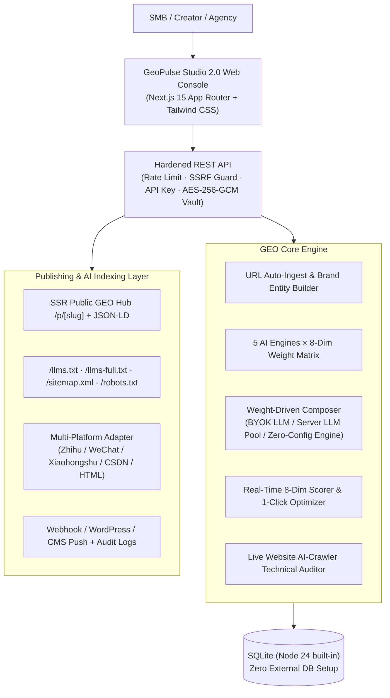

# 🚀 GeoPulse Studio 2.0 — 智引 GEO 商用生成式引擎优化与发布系统

> **Open-Source Commercial Generative Engine Optimization (GEO / AEO) SaaS Platform**
> Built for SMBs, Solo Founders, Content Teams & Digital Agencies to architect, audit, publish, and track high-citation brand content across **Doubao/Yuanbao, DeepSeek/Kimi/Metaso, ChatGPT Search, Perplexity, and Google AI Overviews (Gemini)**.

[](LICENSE)
[](https://nextjs.org)
[-339933)](https://nodejs.org)
[](Dockerfile)

### 🔗 Live Demos & Links
- **GitHub Repository**: https://github.com/sylvia-ccc/geopulse-studio
- **Hugging Face Space**: https://huggingface.co/spaces/sylviacccyu/geopulse-studio
- **US Live Demo Server**: `http://43.162.105.20:3100` *(Demo Admin: `demo@geopulse.ai` / `Demo123456!` · 1-Click Login Available)*

---

## ✨ Why GeoPulse Studio? (Benchmarked Against Top Commercial GEO Tools)

Most GEO tools charge **$99–$1,500/month** just for monitoring. **GeoPulse Studio 2.0** combines **monitoring + weight-driven content architecture + real-time 8-dimension auditing + AI-crawler publishing infrastructure + ready-to-monetize SaaS licensing** in a single self-hostable zero-dependency stack.

| Capability | GeoPulse Studio 2.0 | Profound / Peec AI | Scrunch AI | Otterly.ai |
| :--- | :---: | :---: | :---: | :---: |
| **5 Major AI Engines × 8-Dim Weight Matrix** (CN + Global) | ✅ Customizable Sliders | Monitoring Only | Partial | Monitoring Only |
| **URL Auto-Ingest Brand Entity Builder** | ✅ 1-Click | ✅ | ✅ | Manual |
| **Live Website AI-Crawler Audit** (`robots.txt`/`llms.txt`/JSON-LD/SSR) | ✅ Built-in + Fix Snippets | ❌ | ✅ | ❌ |
| **Real-Time GEO Content Auditor & 1-Click Optimizer** | ✅ 8-Dim + 6 Auto-Fixes | ❌ | Partial | ❌ |
| **Batch Matrix Generator + Existing Article Import** | ✅ 3–6x Batch + Rewrite | ❌ | ❌ | ❌ |
| **Competitor Share of Voice (SOV) & Citation Domains** | ✅ + 12 Funnel Prompts | ✅ | Partial | ✅ |
| **Native SSR GEO Hub (`/p/[slug]`, `/llms.txt`, `/sitemap.xml`)** | ✅ Auto-Generated | ❌ | Partial | ❌ |
| **Multi-Channel Adapter (Zhihu/WeChat/XHS/CSDN/Webhook)** | ✅ Built-in | ❌ | ❌ | ❌ |
| **White-Label Client Delivery Report (PDF/HTML)** | ✅ 1-Click Export | Enterprise Only | Enterprise Only | ❌ |
| **Self-Host Commercial SaaS (License Codes + Admin + BYOK Vault)** | ✅ Open-Source Ready | Closed SaaS | Closed SaaS | Closed SaaS |

---

## 🧠 Architecture Overview



---

## 🎯 Core Commercial Features（核心商业价值）

1. **极简品牌建档 + 官网 URL 一键抓档**：输入官网链接自动提取品牌定位、卖点、价格与实测证据；支持一键导出**白标客户交付报告（HTML / 打印 PDF）**。
2. **5 大 AI 引擎 × 8 维权重矩阵**：覆盖 **豆包/元宝、DeepSeek/Kimi/秘塔、ChatGPT Search、Perplexity、Google AI Overviews**，支持自由拖动 8 维权重滑块调整文章架构与打分权重。
3. **三合一 GEO 创作工坊**：
   - 单篇选题蓝图 + 高权重生文
   - 一键批量生成 3 篇核心矩阵（对比评测 + 选型清单 + FAQ）
   - 已有旧文粘贴体检与一键补全提权 + 实时渲染预览
4. **官网 AI 爬虫技术体检**：实测 6 大 AI 爬虫（`GPTBot`、`OAI-SearchBot`、`PerplexityBot`、`ClaudeBot`、`Google-Extended`、`Bytespider`）权限、`/llms.txt`、SSR 与 JSON-LD，附可复制修复代码。
5. **AI 收录监测与竞品声量份额（SOV）**：追踪品牌提及率、同场竞品声量占比、高频被引来源域名分布、AI 幻觉预警，以及一键生成 12 条买方全漏斗提问词库。
6. **原生 AI 爬虫托管专栏 + 多渠道分发**：SSR 公开页 `/p/[slug]` 自动挂载四合一 JSON-LD，动态更新 `/llms.txt`、`/llms-full.txt`、`/sitemap.xml`、`/robots.txt`；一键适配知乎、公众号 HTML、小红书、CSDN/掘金与 Webhook 自动推送。
7. **完整商用 SaaS 变现底座**：内置账号鉴权、三档套餐配额、管理员「商用运营后台」批量发码（`GP-PRO-XXXX-XXXX`）、服务端全局 LLM 算力池、BYOK `AES-256-GCM` 密钥加密保险箱、SSRF 防护与接口限流。

---

## ⚡ Quick Start（快速启动）

Requires **Node.js >= 22.13** (Node 24 recommended — uses built-in `node:sqlite` with zero external database setup).

```bash
git clone https://github.com/sylvia-ccc/geopulse-studio.git
cd geopulse-studio
npm install
cp .env.example .env
npm run dev
```

Open `http://localhost:3000`:
- **Demo Admin**: `demo@geopulse.ai` / `Demo123456!` *(or click "一键进入演示工作台")*
- **Sample Activation Codes**: `GP-PRO-2026-DEMO` (Pro 30d), `GP-ENT-2026-VIP1` (Enterprise 365d)

---

## 🚢 Production Server Deployment（自有服务器一键部署）

### Option A: One-Command VPS Deploy + Automatic HTTPS (Caddy)
```bash
DOMAIN=geo.yourdomain.com ADMIN_EMAIL=you@yourdomain.com bash deploy/deploy.sh
```

### Option B: Docker Compose (Standalone Port / Existing Nginx)
```bash
cp .env.example .env
# Edit NEXT_PUBLIC_APP_URL, SESSION_SECRET, ADMIN_EMAIL
docker compose up -d --build
```
See [deploy/nginx.conf](deploy/nginx.conf) for reverse-proxy setup and [deploy/backup-db.sh](deploy/backup-db.sh) for automated daily SQLite online backups.

---

## 💼 Commercialization & Acquisition Inquiries（商业合作与源码定制）

This repository is MIT-licensed for community use, self-hosting, and evaluation. For commercial white-label deployment, multi-tenant enterprise licensing, custom AI crawler integrations, or acquisition inquiries, please open a GitHub Discussion / Issue or contact the repository owner.

---

## 🧪 Testing & Verification

```bash
npm test            # Run all Vitest unit tests (16 tests)
npx tsc --noEmit    # Strict TypeScript check
npm run build       # Production build
```
